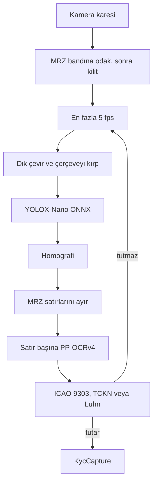

# flutter_ondevice_kyc

On-device KYC for identity-card MRZ and payment-card numbers. The scan path does not open a socket and does not write the frame.

Kimlik kartı, pasaport MRZ'si ve kart numarasını cihazda okuyan Flutter paketi. Sonuç yalnızca ICAO 9303 veya Luhn tutunca yayınlanır. Tutmayan kare bir hata değildir; sonraki kare okunur.

Kod [MIT](LICENSE). Dedektör YOLOX-Nano, tanıyıcı resmi `en_PP-OCRv4_mobile_rec`; ikisi de Apache-2.0. CVV, NFC ve yüz eşleştirme yoktur.

## Ne okur

| Belge | Biçim | Koşul |
| --- | --- | --- |
| T.C. kimlik kartı arkası, TD1 kimlik | 3×30 | ICAO check digit. MRZ içindeki 11 hane TCKN ise o da tutulmalıdır |
| Pasaport | TD3, 2×44 | ICAO check digit |
| Eski kitapçık / TD2 | 2×36 | ICAO check digit |
| Banka kartı | 13–19 hane | Luhn. CVV okunmaz |

İsim satırının check digit'i yoktur. Yeşil kilit belge numarası, doğum, son kullanma ve bileşik haneyi tutunca basılır. MRZ Latin harfle gelir; Ş, Ğ, Ü bu satırlarda yoktur.

Dedektör sentetik dikdörtgenlerle ince ayarlandı. Gerçek kartta satırlar çerçeveye oturunca okuma yine denenir. Gerçek kimlik fotoğrafı bu repoda yoktur.

## Hat



Çalışma zamanı `flutter_onnxruntime` 1.9, varsayılan sağlayıcı CPU. XNNPACK ve CoreML `KycExecutionProvider` ile açılır. NNAPI küçük ağda yavaşladığı ve Android 15'te kalktığı için varsayılan değildir.

## Çalıştırma

Flutter 3.24 veya üstü. Örnek uygulama modelleri `example/assets/models/` içindedir.

```bash
flutter pub get
flutter test
cd example
flutter pub get
flutter test
flutter run
```

Tara sekmesi arka kamerayı açar, çerçevenin altındaki üç çizgiye odaklanır ve netliği kilitler. Bulanık kalırsa görüntüye dokunun. Doğrulama sekmesi yapıştırılan metni kilitler; bu okuma belgeden gelmez.

Android yayın derlemesi R8 kullanır. `example/android/app/proguard-rules.pro` ONNX Runtime sınıflarını tutar. Bu kural olmadan `OrtSession.run` sürüm paketinde süreci düşürür.

## API

```dart
final scanner = await KycScanner.onnx();
final decision = await scanner.scanStill(image);
if (decision is ScanLocked) {
  final capture = decision.capture;
}
await scanner.dispose();
```

Model dosyası yokken `KycScanner.fixture()` ICAO örnek MRZ'sini kilitler. `ScanRejected` exception değildir. `checkManual` yapıştırılan metin içindir. `redactPan` log içindir; tam numara `KycCapture.cardNumber` üzerindedir ve host bunu saklamamalıdır.

## Modeller

Ağırlıklar `example/assets/models/` altındadır. Özet ve SHA-256 için [assets/models/README.md](assets/models/README.md).

| Dosya | Kaynak | Boyut |
| --- | --- | --- |
| `card_detector.onnx` | YOLOX-Nano, 3 sınıf, 416, FP32 | 8.6 MB |
| `text_rec.onnx` | `en_PP-OCRv4_mobile_rec`, opset 11, FP32 | 7.3 MB |
| `en_dict.txt` | PaddleOCR İngilizce sözlük, `<` dahil | 190 B |

Eğitim betikleri `training/` içindedir. Ara kontrol noktaları ve sentetik görüntüler git dışındadır. Dedektör INT8 yalnızca kalibrasyonla ve mAP korunursa uygulanır; tanıyıcı FP32 kaldı.

## Gizlilik

`lib/` `dart:io` veya bir HTTP istemcisi kullanmaz. Kare bellekte işlenir ve loga PAN veya MRZ yazılmaz. Örnek uygulamanın ana Android manifestinde internet izni yoktur. Bu bir hukuk belgesi değildir: tarama yolunun ağ açmadığını ve görüntü yazmadığını söyler.
