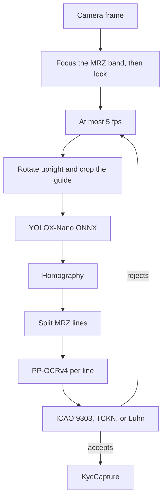

# flutter_ondevice_kyc

On-device KYC for an identity-card MRZ and a payment-card number. The scan path does not open a socket and does not write the frame.

A frame is published only when ICAO 9303 or Luhn accepts it. A miss is a rejected frame, not an exception. The name line has no check digit. The green lock waits on the document number, dates, and composite digit.

The code is [MIT](LICENSE). The detector is YOLOX-Nano and the recognizer is the official `en_PP-OCRv4_mobile_rec`. Both weights are Apache-2.0. This version has no CVV, NFC, or face match.

Turkish process notes: [doc/on-device-kyc.tr.md](doc/on-device-kyc.tr.md).

## What it reads

| Document | Shape | Gate |
| --- | --- | --- |
| Identity card back, including the Turkish card | TD1, 3×30 | ICAO check digits. An 11-digit run in the optional data must also pass the TCKN test |
| Passport | TD3, 2×44 | ICAO check digits |
| Older booklet | TD2, 2×36 | ICAO check digits |
| Payment card | 13–19 digits | Luhn. The CVV is not read |

Names come out in MRZ Latin. Turkish dotted letters are not in those lines.

The detector was fine-tuned on synthetic rectangles. A real card is still read when the MRZ lines sit in the frame. This repository does not contain photographs of real identity documents.

## Pipeline



Runtime is `flutter_onnxruntime` 1.9. The default provider is CPU. XNNPACK and CoreML are opt-in through `KycExecutionProvider`. NNAPI is not a default: it is slow on these small graphs and it is deprecated on Android 15.

## Integrate

The host app owns the model files. Copy `example/assets/models/` into the host assets and list the three files in the host `pubspec.yaml`. Digests are in [assets/models/README.md](assets/models/README.md).

```yaml
dependencies:
  flutter_ondevice_kyc: ^1.0.0

flutter:
  assets:
    - assets/models/card_detector.onnx
    - assets/models/text_rec.onnx
    - assets/models/en_dict.txt
```

```dart
final scanner = await KycScanner.onnx(
  detectorAsset: 'assets/models/card_detector.onnx',
  recognizerAsset: 'assets/models/text_rec.onnx',
  dictionaryAsset: 'assets/models/en_dict.txt',
);

KycScanView(
  scanner: scanner,
  onLocked: (capture) {},
);
```

`KycScanView` opens the back camera, draws the card guide and the three MRZ marks, and locks focus on that band. `onLocked` runs when a checksum matches.

Android: the plugin manifest adds `CAMERA`, and `consumer-proguard.pro` keeps `ai.onnxruntime.**` so a minified release build does not rename the ONNX Runtime classes. iOS: add `NSCameraUsageDescription` to the host `Info.plist`, and set the deployment target to 16.0. The plugin cannot write that string for you.

## Run

Flutter 3.24 or newer. The example is a host app: its models live in `example/assets/models/`.

```bash
flutter pub get
flutter test
cd example
flutter pub get
flutter test
flutter run
```

The scan tab embeds `KycScanView`. Tap the image to focus again. The validation tab locks pasted text. That lock did not come from a document.

## API

```dart
final scanner = await KycScanner.onnx(
  detectorAsset: 'assets/models/card_detector.onnx',
  recognizerAsset: 'assets/models/text_rec.onnx',
  dictionaryAsset: 'assets/models/en_dict.txt',
);
final decision = await scanner.scanStill(image);
if (decision is ScanLocked) {
  final capture = decision.capture;
}
await scanner.dispose();
```

`KycScanner.fixture()` locks the ICAO specimen when the weight files are absent. `ScanRejected` is not an exception. `checkManual` is for pasted text. `redactPan` is for logs. The full number lives on `KycCapture.cardNumber`, and the host should not store it.

## Models

Weights live in `example/assets/models/`. Digests are in [assets/models/README.md](assets/models/README.md).

| File | Source | Size |
| --- | --- | --- |
| `card_detector.onnx` | YOLOX-Nano, 3 classes, 416, FP32 | 8.6 MB |
| `text_rec.onnx` | `en_PP-OCRv4_mobile_rec`, opset 11, FP32 | 7.3 MB |
| `en_dict.txt` | PaddleOCR English dictionary, including `<` | 190 B |

Training scripts are in `training/`. Checkpoints and generated images stay out of git. Detector INT8 is only worth doing with a calibration set that keeps detection quality. The recognizer stayed FP32.

## Privacy

`lib/` does not import `dart:io` or an HTTP client. A frame stays in memory. Logs do not contain a PAN, an MRZ line, or a TCKN. The example Android manifest has no internet permission. This is not a legal opinion. It states that the scan path does not open a network connection and does not write an image.

## Versions and contributions

Versioning is in [VERSIONING.md](VERSIONING.md). Contributions are in [CONTRIBUTING.md](CONTRIBUTING.md). A pull request must name an open issue that a maintainer has labeled `accepted`. Other pull requests are closed.
